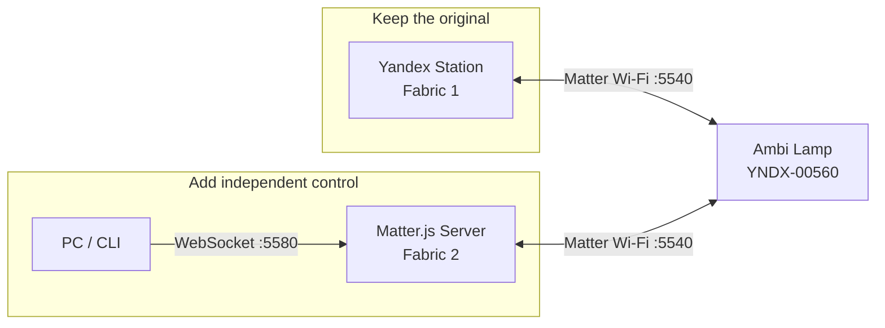
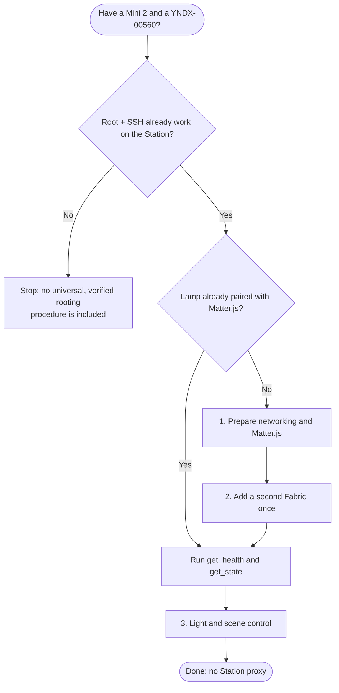

# Yandex Ambi Lamp — direct control without relying on Alice

**A guided, illustrated path from a prepared lab to an independent Matter controller.**

[**Русская версия**](00_START_RU.md) · [Preparation](01_SETUP_EN.md) · [Pairing](02_PAIR_EN.md) · [Controls](03_CONTROL_EN.md) · [Troubleshooting](04_RECOVERY_EN.md)

> This is **plain GitHub Markdown**, not a website. Diagrams render in GitHub. Commands are copyable, with a prerequisite, expected outcome, and safe stop procedure for every consequential step.

## What will you get?

You will preserve the original Yandex control path **and add a second independent one**: PC → Matter.js → YNDX-00560. The tested setup supports On/Off, brightness, color, color temperature, and four built-in scenes. After pairing, the Station is not involved in these commands.

## Where should you start?

| Starting point | Go to | Expected outcome |
|---|---|---|
| Root/SSH works; no second Fabric | [Preparation →](01_SETUP_EN.md) | Matter.js healthy; private backup |
| Server ready; first pairing needed | [Multi-Admin →](02_PAIR_EN.md) | Second Fabric; TCP/8765 closed |
| Lamp already in Matter.js | [Controls →](03_CONTROL_EN.md) | Direct `get_state` and scene |
| Something failed | [Troubleshooting →](04_RECOVERY_EN.md) | Recover without factory reset |

## Prerequisites

**Hardware:** Mini 2 without clock (root/SSH already enabled), YNDX-00560 (already paired with Yandex), a Linux host, reachable LAN.

**Software:** Ubuntu 22.04.5 LTS, Docker/Compose, Node.js 22, Windows PowerShell 7 for the proven lifecycle, Git/OpenSSH, Zig for the temporary helper.

> **Privacy:** Do not commit real IPs, SSH host aliases, private keys, pairing codes, Matter `/data`, or PCAPs. Use only `REPLACE_WITH_...` placeholders in shared material.

## Continue

**[01 · Set up the server](01_SETUP_EN.md)** → **[02 · Pair once](02_PAIR_EN.md)** → **[03 · Control lights](03_CONTROL_EN.md)** → **[04 · Troubleshoot safely](04_RECOVERY_EN.md)**

<b>What is verified, and what is not?</b>

**Hardware verified:** two Fabrics, direct CASE/Read, light/color/temperature, four scenes, persistence recovery and direct control when the Station is powered off.

**Not verified:** rooting another firmware, Home Assistant end-to-end, individual LEDs, third-party color-music UDP/4048 playback.

