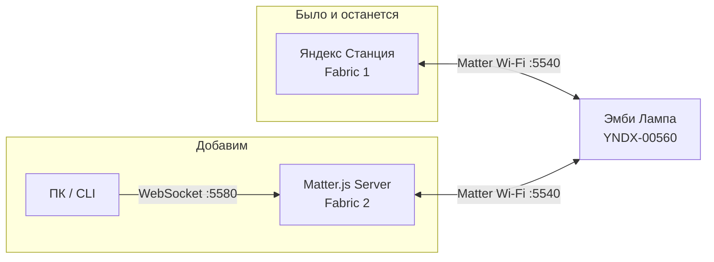
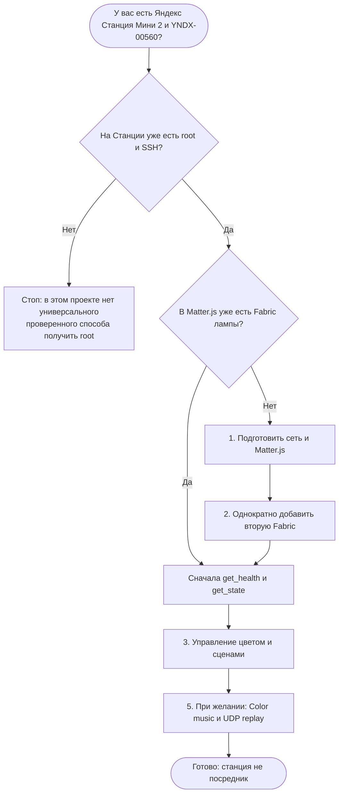

# Эмби Лампа без зависимости от Алисы

**Пошаговое руководство: от подготовленного стенда до собственного Matter-управления.**

[**English version**](00_START_EN.md) · [Подготовка](01_SETUP_RU.md) · [Подключение](02_PAIR_RU.md) · [Управление](03_CONTROL_RU.md) · [Светомузыка](05_COLOR_MUSIC_RU.md) · [Решение проблем](04_RECOVERY_RU.md)

> **Это обычная документация GitHub**, а не сайт. Диаграммы раскрываются прямо в Markdown. Команды можно копировать; каждое опасное действие имеет условие запуска, проверку результата и план остановки.

## Что будет в результате?

Вы сохраните управление лампой из Яндекса, но получите **второй, независимый канал**: ПК → Matter.js → Эмби Лампа YNDX-00560. На проверенном стенде доступны включение, яркость, цвет, цветовая температура, четыре штатные сцены и независимое **включение Color music с воспроизведением UDP/4048**. После сопряжения Станция не требуется для этих действий. Генерация светомузыки из произвольного аудио пока не проверена на лампе.

**Два независимых контроллера, одна лампа, исходная Fabric Яндекса не удаляется.**

## Выберите, с какого этапа начать

| Ваше состояние | Куда перейти | Результат этапа |
|---|---|---|
| Есть root/SSH, ещё нет второй Fabric | [Подготовка →](01_SETUP_RU.md) | Matter.js healthy, сохранён backup |
| Matter.js готов, нужно первое сопряжение | [Multi-Admin →](02_PAIR_RU.md) | Вторая Fabric, закрытый TCP/8765 |
| Лампа уже в Matter.js | [Управление →](03_CONTROL_RU.md) | Первый прямой `get_state` и эффект |
| Нужно воспроизвести светомузыку | [Color music →](05_COLOR_MUSIC_RU.md) | Matter enable + UDP replay; скрипты пока локальные |
| Что-то пошло не так | [Диагностика →](04_RECOVERY_RU.md) | Безопасные проверки без сброса |

## Что понадобится

**Оборудование:** Яндекс Станция Мини 2 без часов (уже root/SSH), YNDX-00560 (уже связана с Яндексом), Linux-компьютер/сервер, доступная общая LAN. 

**Программы:** Ubuntu 22.04.5 LTS, Docker + Compose, Node.js 22, PowerShell 7 на Windows (для проверенного lifecycle), Git/OpenSSH, Zig для сборки временного helper.

> **Приватность:** реальные адреса, SSH-имена, ключи, Matter `/data`, pairing-коды и PCAP **не нужны для публикации**. В документации используются только `REPLACE_WITH_...`. Не добавляйте локальные отчёты в Git.

## Куда пойдём дальше

**[01 · Подготовить сервер и сеть](01_SETUP_RU.md)** → **[02 · Привязать лампу один раз](02_PAIR_RU.md)** → **[03 · Управлять эффектами](03_CONTROL_RU.md)** → **[05 · Светомузыка](05_COLOR_MUSIC_RU.md)** · **[04 · Диагностика](04_RECOVERY_RU.md)**

<b>Что подтверждено, а что пока нет?</b>

**Проверено на реальной лампе:** две Fabrics, прямой CASE/Read, On/Off, Brightness, Hue/Saturation, ColorTemperature, `set_scene fire`, `rainbow`, `northern_lights`, `lava_lamp`, восстановление из `/data` и управление при выключенной Станции.

**Теперь также подтверждено на оборудовании:** включение Color music через независимую Matter Fabric и UDP replay с Ubuntu, включая пульсацию при физически отключённой Станции.

**Не подтверждено:** root на другой прошивке; полная интеграция Home Assistant; индивидуальные LED; генерация собственного live FFT → UDP потока. Исходные скрипты replay пока не опубликованы.

