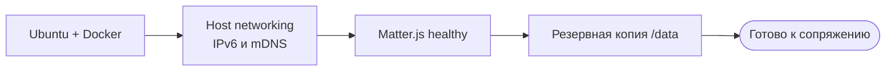

# 01 · Подготавливаем стенд

[← Начало](00_START_RU.md) · [Далее: сопряжение →](02_PAIR_RU.md) · [English](01_SETUP_EN.md)

**Цель главы:** Matter.js Server запускается, доступен с управляющего ПК, сеть готова для Matter, сделана приватная резервная копия. Лампу и Станцию здесь **не перенастраиваем**.



## Шаг 1. Убедитесь, что у вас правильная версия проекта

**Где:** терминал Git, на машине, где будут выполняться команды.

```bash
git clone https://github.com/r0ka-op/yandex-station-matter-bridge.git
cd yandex-station-matter-bridge
git fetch origin
# До объединения PR с документацией:
git switch docs/bilingual-reproduction-runbook
```

**Как понять, что всё правильно:** существуют `deploy/matter-server-direct/Dockerfile`, `deploy/matter-server/docker-compose.ubuntu.yml`, `tools/matter_lamp/matter-lamp-client.mjs`. После объединения документации и PR со сценами используйте `main`.

## Шаг 2. Проверьте сеть (без изменения настроек)

**Где:** Ubuntu-сервер.

```bash
ip -br address
ip -6 route
# Вставьте имя вашего интерфейса, найденное выше:
LAN_IF="REPLACE_WITH_LAN_INTERFACE"
ip maddr show dev "$LAN_IF"
ss -lntup
avahi-browse -rt _matterc._udp
```

| Должно быть | Если не так |
|---|---|
| LAN-интерфейс поднят, IPv6 link-local доступен | Исправить сетевую конфигурацию до сопряжения |
| Доступны multicast/mDNS UDP/5353 и Matter UDP/5540 | Проверить клиентскую изоляцию Wi-Fi и firewall |
| `_matterc._udp` пока не виден | **Это нормально:** окно сопряжения ещё закрыто |

> **Не делайте:** factory reset или повторную настройку Яндекса в попытке починить mDNS.

## Шаг 3. Соберите наш контейнер Matter.js

**Где:** Ubuntu, из корня checkout. Требуется установленный Docker Engine и Compose.

```bash
docker build -t yandex-matterjs-server:1.5.5-direct-v1 deploy/matter-server-direct
mkdir -p "$HOME/matter-lab/matter-data"
cp deploy/matter-server/docker-compose.ubuntu.yml "$HOME/matter-lab/compose.yml"
```

Отредактируйте **локальную копию** `$HOME/matter-lab/compose.yml`:

| Поле | Что установить | Зачем |
|---|---|---|
| `PRIMARY_INTERFACE` | Ваш LAN-интерфейс | Чтобы найти лампу |
| `LISTEN_ADDRESS` | `127.0.0.1,<LAN_INTERFACE>` | Не слушать на публичном интерфейсе |
| `STORAGE_PATH` и volume | `/data`, `./matter-data:/data` | Чтобы Fabric пережила перезапуск |
| `ENABLE_TEST_NET_DCL` | `"true"` | В проверенном случае требовалась тестовая trust chain |
| `DISABLE_AUTO_SUBSCRIPTION` | `"true"` | Обход `peer-ack-missing` при bootstrap |
| `YNDX00560_DIRECT_INVOKE_NODE_ID` | **УДАЛИТЬ строку** до сопряжения | Образцовый `2` — не Node ID вашей лампы |

**Не отключайте проверку attestation.** Не добавляйте приватный `compose.yml` в Git.

```bash
cd "$HOME/matter-lab"
docker compose up -d
docker compose ps
docker inspect --format '{{.State.Health.Status}} {{.RestartCount}}' matterjs-server
```

**Ожидаемый результат:** `healthy` и счётчик перезапусков `0`. Если контейнер не healthy, выполните `docker compose logs --tail=100 matter-server` и **не переходите к сопряжению**.

## Шаг 4. Сделайте резервную копию, пока сервер остановлен

**Где:** Ubuntu. Ниже используется отдельная папка вне репозитория.

```bash
mkdir -p "$HOME/matter-private-backups"
chmod 700 "$HOME/matter-private-backups"
cd "$HOME/matter-lab"
docker compose stop matter-server
umask 077
tar -C "$HOME/matter-lab" -czf "$HOME/matter-private-backups/before-ecm.tgz" matter-data
chmod 600 "$HOME/matter-private-backups/before-ecm.tgz"
docker compose start matter-server
```

**Проверка:** сервер снова healthy, приватный архив существует. Он содержит чувствительные данные Matter Fabric; **никогда не публикуйте его**.

## Шаг 5. Проверка Станции без изменений

**Где:** Windows PowerShell 7, корень checkout. На Станции уже должен работать SSH под root.

```powershell
$StationAlias = 'REPLACE_WITH_SSH_ALIAS'
$PrivateDir = 'REPLACE_WITH_PRIVATE_ABSOLUTE_PATH'
& .\scripts\check_maind_http_station_readiness.ps1 -SshAlias $StationAlias -OutputPath (Join-Path $PrivateDir 'station-readiness.json')
```

**PASS:** ровно один штатный `maind --platformd`, ожидаемые SHA-256 `maind`/`quasar_launcher2`, закрыт TCP/8765, нет незавершённого эксперимента. При несовпадении SHA/прошивки **остановитесь**: нельзя просто снять запрет или запустить скрипт на неизвестной сборке.

**Перед продолжением проверьте:**

- [ ] Matter.js healthy, каталог `/data` постоянный.
- [ ] Сеть поддерживает IPv6, mDNS и Matter.
- [ ] Приватный backup сделан **вне Git**.
- [ ] Station readiness = PASS, TCP/8765 закрыт.

**Всё выполнено? [Перейти к однократному сопряжению →](02_PAIR_RU.md)**