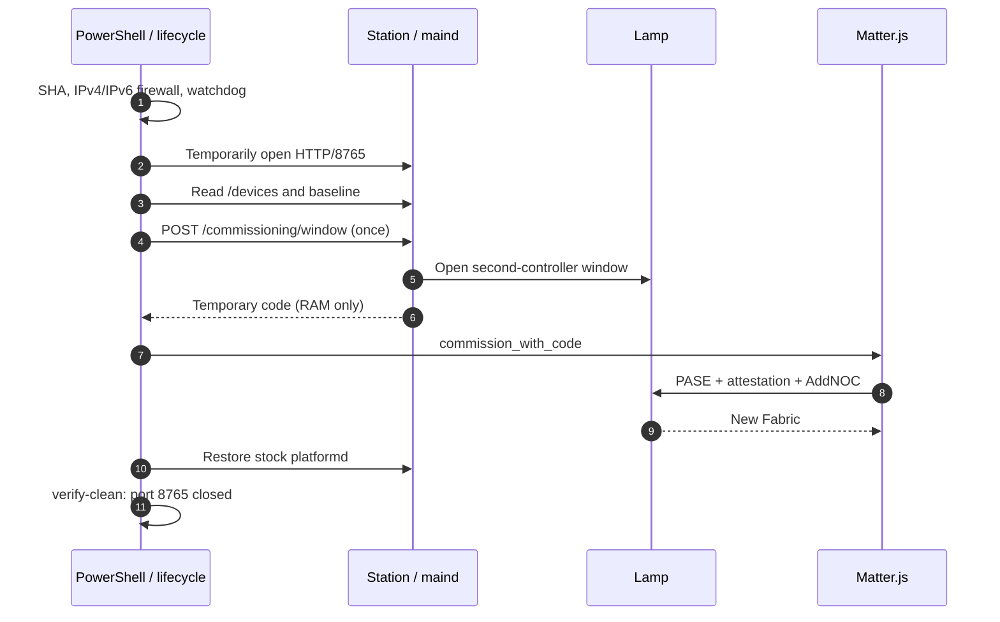
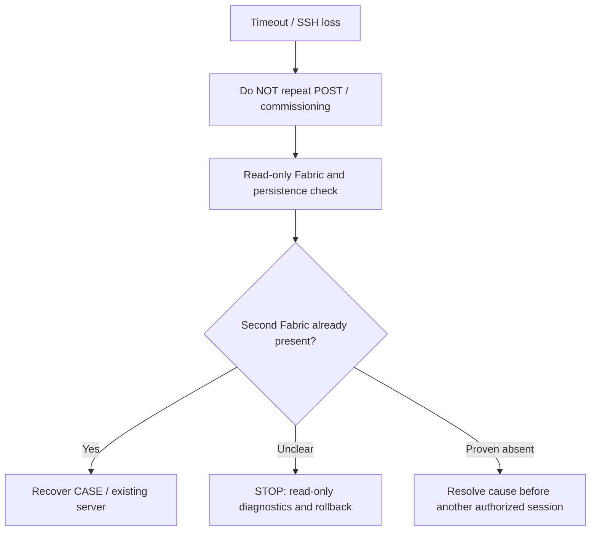

# 02 · Add Matter.js as a second administrator

[← Preparation](01_SETUP_EN.md) · [Next: Controls →](03_CONTROL_EN.md) · [Русский](02_PAIR_RU.md)

**Goal:** add a separate Matter Fabric **once**, preserving Yandex's original Fabric. This is the only stage that temporarily enables the Station's internal API.

> **First read** the [complete, tested 20-step procedure](../multi_admin/HOW_TO_ADD_SECOND_CONTROLLER_EN.md). This page makes it easier to follow but does not supersede the guarded original lifecycle.

## What actually happens



## Before starting

| Check | Required state |
|---|---|
| Station | Root/SSH, expected firmware and hashes, original `maind --platformd` |
| Matter.js | `healthy`, private `/data` backed up |
| LAN | IPv6 and mDNS available, lamp reachable |
| Node identity | Actual **Yandex-Fabric Node ID**, from authorized read-only `/devices` |
| Guards | IPv4+IPv6 firewall plus independent Station watchdog in the audited script |

**If the second Fabric already exists, skip this page.** Go to [controls](03_CONTROL_EN.md).

## Run one session, exactly once

**Where:** Windows PowerShell 7, repository root. Replace placeholders *locally*, never commit real addresses or identifiers.

```powershell
$StationAlias = 'REPLACE_WITH_SSH_ALIAS'
$StationIPv4 = 'REPLACE_WITH_STATION_IPV4'
$StationIPv6 = 'REPLACE_WITH_STATION_IPV6'
$MatterUri = [uri]'ws://REPLACE_WITH_SERVER_IP:5580/ws'
$YandexFabricNodeId = [uint64]0  # Replace with verified positive Yandex-Fabric Node ID

& .\scripts\start_maind_http_multi_admin_ecm.ps1 `
  -ConfirmToken I_APPROVE_ONE_MULTI_ADMIN_ECM_SESSION `
  -SshAlias $StationAlias `
  -StationIPv4 $StationIPv4 `
  -StationIPv6 $StationIPv6 `
  -ExpectedNodeId $YandexFabricNodeId `
  -MatterServerWebSocketUri $MatterUri `
  -CommissioningTimeoutSeconds 600 `
  -MatterJsDiscoveryTimeoutSeconds 300 `
  -WatchdogSeconds 1500 `
  -Discriminator 0
```

**PASS — illustrative report shape, not a new device's actual log:**

```text
commissioning_window: PASS
matterjs_commissioning: SUCCESS
commissioned_fabrics: 1 -> 2
rollback: PASS
verify_clean: PASS
```

After success, **TCP/8765 is closed**, original `platformd` is restored, and the second Fabric is reachable through Matter.js. Do not put pairing codes or QR content in public logs.

## If the command hangs or SSH drops



In the tested setup, `AddNOC/CommissioningComplete` succeeded but `get_nodes=[]` followed a `peer-ack-missing` error. Persistence recovery using the **same** `/data` worked; blind recommissioning was unnecessary.

**Before continuing, verify:**

- [ ] New Fabric exists and original Yandex Fabric remains.
- [ ] Matter.js operational Node ID discovered and stored privately.
- [ ] `rollback` and `verify-clean` PASS, TCP/8765 closed.
- [ ] No reflash, bootloader changes or factory reset.

**[Go to independent control →](03_CONTROL_EN.md)**