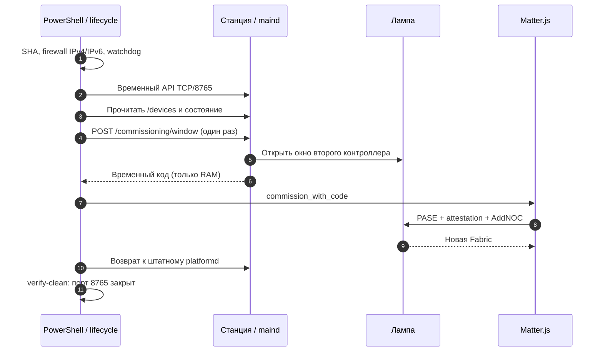
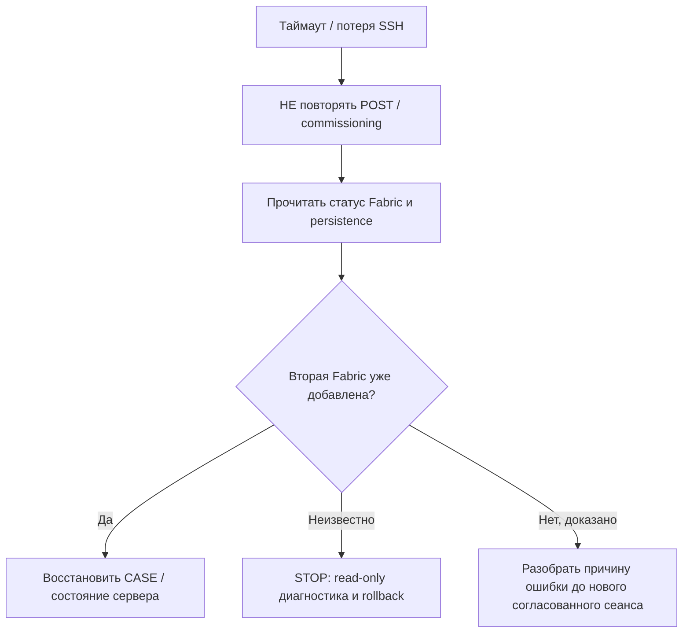

# 02 · Добавляем Matter.js как второго администратора

[← Подготовка](01_SETUP_RU.md) · [Далее: управление →](03_CONTROL_RU.md) · [English](02_PAIR_EN.md)

**Цель:** добавить отдельную Matter Fabric **один раз** и оставить исходную Fabric Яндекса без изменений. Это единственный этап, где временно активируется внутренний API Станции.

> **Сначала прочитайте** [полную проверенную 20-шаговую процедуру](../multi_admin/HOW_TO_ADD_SECOND_CONTROLLER.md). Этот раздел объясняет её понятным языком, но не заменяет защиты и аварийный порядок выполнения исходного lifecycle.

## Что происходит при сопряжении



## Проверки перед нажатием «Пуск»

| Проверка | Что требуется |
|---|---|
| Станция | Root/SSH, firmware и SHA совпадают, `maind --platformd` штатный |
| Matter.js | `healthy`, данные `/data` сохранены и backed up |
| Сеть | IPv6 и mDNS работают, лампа достижима |
| Идентичность | Фактический **Node ID в Yandex Fabric**, полученный из авторизованного read-only `/devices` |
| Защита | IPv4+IPv6 guards и независимый watchdog предусмотрены проверенным скриптом |

**Если вторая Fabric уже существует, не выполняйте этот этап.** Переходите к [управлению](03_CONTROL_RU.md).

## Выполнить ровно один сеанс

**Где:** Windows PowerShell 7, корень checkout. Подставляйте только свои данные **локально**, не коммитьте команды с заполненными параметрами.

```powershell
$StationAlias = 'REPLACE_WITH_SSH_ALIAS'
$StationIPv4 = 'REPLACE_WITH_STATION_IPV4'
$StationIPv6 = 'REPLACE_WITH_STATION_IPV6'
$MatterUri = [uri]'ws://REPLACE_WITH_SERVER_IP:5580/ws'
$YandexFabricNodeId = [uint64]0  # Заменить на реальный положительный Node ID, подтверждённый инвентаризацией

& .\scripts\start_maind_http_multi_admin_ecm.ps1 `
  -ConfirmToken I_APPROVE_ONE_MULTI_ADMIN_ECM_SESSION `
  -SshAlias $StationAlias `
  -StationIPv4 $StationIPv4 `
  -StationIPv6 $StationIPv6 `
  -ExpectedNodeId $YandexFabricNodeId `
  -MatterServerWebSocketUri $MatterUri `
  -CommissioningTimeoutSeconds 600 `
  -MatterJsDiscoveryTimeoutSeconds 300 `
  -WatchdogSeconds 1500 `
  -Discriminator 0
```

**PASS — пример ожидаемой структуры отчёта, не настоящий лог нового устройства:**

```text
commissioning_window: PASS
matterjs_commissioning: SUCCESS
commissioned_fabrics: 1 -> 2
rollback: PASS
verify_clean: PASS
```

После успешного сеанса **TCP/8765 снова закрыт**, оригинальный `platformd` восстановлен, новая Fabric доступна по Matter.js. Секретный manualCode/QR **не выводится в публичный журнал**.

## Если команда зависла или оборвалась



Проверенный случай: после `AddNOC/CommissioningComplete` случался `peer-ack-missing`, а `get_nodes=[]`. Вторая Fabric при этом существовала и **восстановилась после перезапуска прежнего Matter.js с тем же `/data`**. Слепое повторение сопряжения опасно.

**Перед продолжением проверьте:**

- [ ] Вторая Fabric добавлена, исходная Яндекс Fabric сохранена.
- [ ] Operational Node ID получен **из Matter.js** и сохранён приватно.
- [ ] `rollback` и `verify-clean` = PASS, порт 8765 закрыт.
- [ ] Изменение не требует перезагрузки/прошивки/сброса лампы.

**[Перейти к прямому управлению →](03_CONTROL_RU.md)**