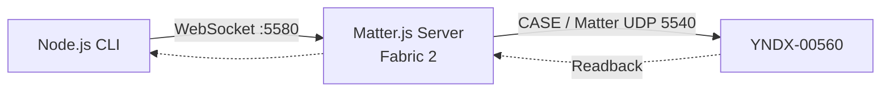
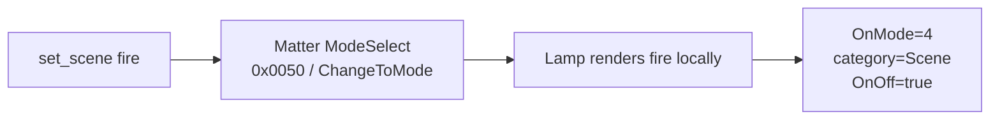

# 03 · Control the lamp and run scenes

[← Pairing](02_PAIR_EN.md) · [Troubleshooting →](04_RECOVERY_EN.md) · [Русский](03_CONTROL_RU.md)

**Goal:** read real device state, change a single property, verify, then restore the original state. The **Station is no longer in the control path**.

## Command flow



## Step 1. Use the actual Matter.js Node ID

Find the node in Matter.js `get_nodes`, not in Yandex's Fabric. In your **private** compose.yml set `YNDX00560_DIRECT_INVOKE_NODE_ID` to the operational Node ID from *this* Fabric. Back up `/data` and reapply the same compose/persistence:

```bash
cd "$HOME/matter-lab"
docker compose up -d
docker compose ps
```

The sample value `2` in the template is **only a lab example**.

## Step 2. Start read-only

**Where:** Node.js 22 host with the repository checkout.

```bash
MATTER_URI="ws://REPLACE_WITH_SERVER_IP:5580/ws"
NODE_ID="REPLACE_WITH_ACTUAL_MATTERJS_NODE_ID"
node tools/matter_lamp/matter-lamp-client.mjs --uri "$MATTER_URI" --node "$NODE_ID" get_health
node tools/matter_lamp/matter-lamp-client.mjs --uri "$MATTER_URI" --node "$NODE_ID" get_state
node tools/matter_lamp/matter-lamp-client.mjs --uri "$MATTER_URI" --node "$NODE_ID" get_capabilities
```

**Expected:** CASE and single-path reads work; `get_state` returns OnOff, brightness, hue/saturation and temperature. Save the **private baseline** before switching anything.

### Running the CLI from Windows PowerShell

The Bash examples use `$MATTER_URI` and `$NODE_ID`; PowerShell has different variable syntax:

```powershell
$MatterUri = 'ws://REPLACE_WITH_SERVER_IP:5580/ws'
$NodeId = 'REPLACE_WITH_ACTUAL_MATTERJS_NODE_ID'
node tools/matter_lamp/matter-lamp-client.mjs --uri $MatterUri --node $NodeId get_health
node tools/matter_lamp/matter-lamp-client.mjs --uri $MatterUri --node $NodeId get_state
# After saving the baseline, a live scene can be tested:
node tools/matter_lamp/matter-lamp-client.mjs --uri $MatterUri --node $NodeId set_scene fire
```

## Step 3. One reversible command

```bash
node tools/matter_lamp/matter-lamp-client.mjs --uri "$MATTER_URI" --node "$NODE_ID" turn_on
node tools/matter_lamp/matter-lamp-client.mjs --uri "$MATTER_URI" --node "$NODE_ID" get_state
```

| Observe | Expected |
|---|---|
| Lamp lights up | Visual confirmation |
| `OnOff` after read | `true` |
| Command times out ambiguously | **Do not retry** a state-changing request before a new read |

## Step 4. Brightness, hue and temperature

```bash
node tools/matter_lamp/matter-lamp-client.mjs --uri "$MATTER_URI" --node "$NODE_ID" set_brightness 50
node tools/matter_lamp/matter-lamp-client.mjs --uri "$MATTER_URI" --node "$NODE_ID" set_color 15 80
node tools/matter_lamp/matter-lamp-client.mjs --uri "$MATTER_URI" --node "$NODE_ID" set_color_temperature 4000
```

| Command | Meaning | Constraints |
|---|---|---|
| `set_brightness 50` | 50% brightness | 1–100% → Matter level 1–254 |
| `set_color 15 80` | Hue 15%, Saturation 80% | each 0–100% → Matter 0–254 |
| `set_color_temperature 4000` | 4000 K | tested lamp 154–370 mired ≈ 2703–6493 K |

The client performs a fresh readback after each command; a successful transport return alone is not proof of success.

## Step 5. Four built-in scenes — no Alice command required



| Effect | Command | Mode ID | Status |
|---|---|---:|---|
| Lava Lamp | `set_scene lava_lamp` | 1 | hardware verified |
| Fire | `set_scene fire` | 4 | hardware verified |
| Northern Lights | `set_scene northern_lights` | 6 | hardware verified |
| Rainbow | `set_scene rainbow` | 13 | hardware verified |

```bash
node tools/matter_lamp/matter-lamp-client.mjs --uri "$MATTER_URI" --node "$NODE_ID" get_scenes
node tools/matter_lamp/matter-lamp-client.mjs --uri "$MATTER_URI" --node "$NODE_ID" set_scene fire
node tools/matter_lamp/matter-lamp-client.mjs --uri "$MATTER_URI" --node "$NODE_ID" get_scene
```

**Expected:** Fire visibly animates; `OnMode=4`, category `Scene=2`, `OnOff=true`.

**Why not show all 24 Quasar scene IDs?** This firmware returns `SupportedModes=""`, `CurrentMode=0`, and stores the last effect in `OnMode`. Only the four verified IDs are allowlisted. Do not confuse generic enum values with support on this lamp.

## Step 6. Restore **your** original light state

From your private baseline, restore the prior color/temperature/brightness and call `turn_off` **only if the lamp was originally off**. Read back after each change. Never use somebody else's snapshot values.

## Next

[**Troubleshooting and rollback →**](04_RECOVERY_EN.md) · [Detailed scene contract](../multi_admin/DIRECT_CONTROL.md)