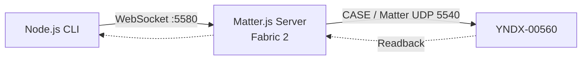
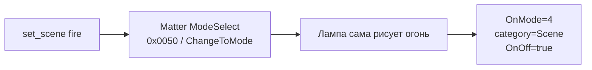

# 03 · Управляем лампой и запускаем эффекты

[← Сопряжение](02_PAIR_RU.md) · [Если ошибка →](04_RECOVERY_RU.md) · [English](03_CONTROL_EN.md)

**Цель:** получить реальный ответ лампы, изменить один параметр, проверить результат и вернуть исходное состояние. **Станция теперь не участвует в маршруте команд.**

## Как команда доходит до лампы



## Шаг 1. Узнайте Node ID **в Matter.js**, а не в Яндексе

Смотрите `get_nodes` в вашем Matter.js. В **приватной** копии compose.yml задайте `YNDX00560_DIRECT_INVOKE_NODE_ID` равным фактическому operational Node ID новой Fabric. Сохраните backup `/data` и примените обновлённый compose с тем же хранилищем:

```bash
cd "$HOME/matter-lab"
docker compose up -d
docker compose ps
```

> Внимание: в примере конфигурации встречается `2`; это лишь Node ID конкретного лабораторного сеанса, **не переносите его** на свой стенд.

## Шаг 2. Сначала только чтение

**Где:** компьютер с Node.js 22, checkout репозитория. Замените значения-заглушки:

```bash
MATTER_URI="ws://REPLACE_WITH_SERVER_IP:5580/ws"
NODE_ID="REPLACE_WITH_ACTUAL_MATTERJS_NODE_ID"
node tools/matter_lamp/matter-lamp-client.mjs --uri "$MATTER_URI" --node "$NODE_ID" get_health
node tools/matter_lamp/matter-lamp-client.mjs --uri "$MATTER_URI" --node "$NODE_ID" get_state
node tools/matter_lamp/matter-lamp-client.mjs --uri "$MATTER_URI" --node "$NODE_ID" get_capabilities
```

**Ожидается:** устройство доступно, CASE и одиночные Direct Read проходят; `get_state` возвращает OnOff, brightness, hue/saturation, температуру. **Сохраните свой baseline приватно** до первого включения.

### Если запускаете CLI из Windows PowerShell

В Bash примеры выше используют переменные `$MATTER_URI` и `$NODE_ID`. В PowerShell задайте их отдельно и передавайте как обычные параметры:

```powershell
$MatterUri = 'ws://REPLACE_WITH_SERVER_IP:5580/ws'
$NodeId = 'REPLACE_WITH_ACTUAL_MATTERJS_NODE_ID'
node tools/matter_lamp/matter-lamp-client.mjs --uri $MatterUri --node $NodeId get_health
node tools/matter_lamp/matter-lamp-client.mjs --uri $MatterUri --node $NodeId get_state
# После сохранения baseline можно выполнить реальный эффект:
node tools/matter_lamp/matter-lamp-client.mjs --uri $MatterUri --node $NodeId set_scene fire
```

## Шаг 3. Первая обратимая команда

```bash
node tools/matter_lamp/matter-lamp-client.mjs --uri "$MATTER_URI" --node "$NODE_ID" turn_on
node tools/matter_lamp/matter-lamp-client.mjs --uri "$MATTER_URI" --node "$NODE_ID" get_state
```

| Что наблюдать | Значение |
|---|---|
| Лампа включилась | Визуальное подтверждение |
| `OnOff` после чтения | `true` |
| Не удалось получить ответ | **Не повторять** изменяющую команду после неопределённого timeout; сначала свежий `get_state` |

## Шаг 4. Цвет, яркость и температура

```bash
node tools/matter_lamp/matter-lamp-client.mjs --uri "$MATTER_URI" --node "$NODE_ID" set_brightness 50
node tools/matter_lamp/matter-lamp-client.mjs --uri "$MATTER_URI" --node "$NODE_ID" set_color 15 80
node tools/matter_lamp/matter-lamp-client.mjs --uri "$MATTER_URI" --node "$NODE_ID" set_color_temperature 4000
```

| Команда | Что значат числа | Аппаратные рамки |
|---|---|---|
| `set_brightness 50` | 50% яркости | 1–100% → Matter level 1–254 |
| `set_color 15 80` | Hue 15%, Saturation 80% | оба 0–100% → Matter 0–254 |
| `set_color_temperature 4000` | 4000 K | на проверенной лампе 154–370 mired ≈ 2703–6493 K |

После каждой операции клиент проверяет состояние повторным Direct Read. Если значения не совпали — не считайте это успехом.

## Шаг 5. Четыре штатных эффекта — без команды Алисе



| Эффект | Команда | Mode ID | Статус |
|---|---|---:|---|
| Лава-лампа | `set_scene lava_lamp` | 1 | аппаратно подтверждён |
| Огонь | `set_scene fire` | 4 | аппаратно подтверждён |
| Северное сияние | `set_scene northern_lights` | 6 | аппаратно подтверждён |
| Радуга | `set_scene rainbow` | 13 | аппаратно подтверждён |

```bash
node tools/matter_lamp/matter-lamp-client.mjs --uri "$MATTER_URI" --node "$NODE_ID" get_scenes
node tools/matter_lamp/matter-lamp-client.mjs --uri "$MATTER_URI" --node "$NODE_ID" set_scene fire
node tools/matter_lamp/matter-lamp-client.mjs --uri "$MATTER_URI" --node "$NODE_ID" get_scene
```

**Что должно произойти:** лампа показывает эффект, `OnMode=4`, категория `Scene=2`, `OnOff=true`.

**Почему `get_scene` не показывает список из 24 сцен?** Прошивка возвращает `SupportedModes=""` и `CurrentMode=0`, а последний выбранный эффект хранит в `OnMode`. Поэтому мы разрешаем четыре проверенных ID и не выдаём общий Quasar enum за список функций лампы.

## Шаг 6. Верните именно **свой** исходный режим

По сохранённому ранее baseline восстановите цвет/температуру/яркость, а затем `turn_off`, **если первоначально лампа была выключена**. Каждый этап подтверждайте `get_state`. Не используйте заранее зашитые чужие значения.

## Что делать дальше

**Следующая подтверждённая функция:** [05 · Светомузыка через Matter и UDP replay →](05_COLOR_MUSIC_RU.md). В отличие от локальных сцен, она требует включения режима через Matter и отдельного UDP-потока. Скрипты replay ещё не опубликованы.

[**Устранение ошибок и откат →**](04_RECOVERY_RU.md) · [Полный технический контракт сцен](../multi_admin/DIRECT_CONTROL.md)