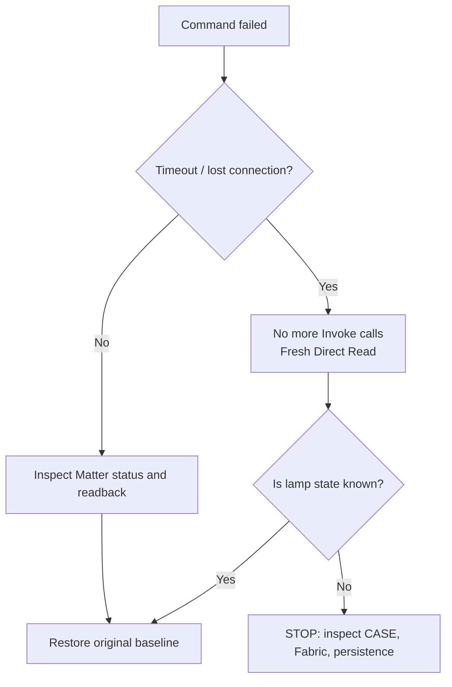

# 04 · Troubleshooting without factory reset

[← Controls](03_CONTROL_EN.md) · [Start page](00_START_EN.md) · [Русский](04_RECOVERY_RU.md)

**Rule #1:** never blindly retry a state-changing command after a timeout. Start with a fresh read.



## Find the issue quickly

| Symptom | Meaning | Inspect | Avoid |
|---|---|---|---|
| `peer-ack-missing` during bootstrap | Auto-subscription issue on this firmware | single Direct Read; `DISABLE_AUTO_SUBSCRIPTION=true` | deleting the Fabric |
| `get_nodes=[]` after AddNOC | Local registration failure is possible | same `/data`, Fabric counters, one controlled restart | recommissioning |
| `Endpoint 1 does not exist` | Incomplete local endpoint model | `get_state`, patched image, correct Node ID | arbitrary raw invokes |
| `available=false` while CASE works | Subscription state differs from direct reachability | single Direct Read | factory reset |
| `SupportedModes=""` | Firmware quirk | `get_scenes`, four verified scenes | brute-forcing 24 enum IDs |
| Node gone after restart | Wrong `/data` or interface | compose volume/image/interface | creating another Fabric blindly |
| Station TCP/8765 still open | Cleanup not complete | verify-clean and guarded rollback | leaving the API exposed |

## Collect diagnostics safely

**Ubuntu** (do not copy `/data` itself):

```bash
cd "$HOME/matter-lab"
docker compose ps
docker inspect --format '{{.State.Health.Status}} {{.RestartCount}}' matterjs-server
docker compose logs --tail=60 matter-server
```

**Client host** (with WebSocket available):

```bash
MATTER_URI="ws://REPLACE_WITH_SERVER_IP:5580/ws"
NODE_ID="REPLACE_WITH_ACTUAL_MATTERJS_NODE_ID"
node tools/matter_lamp/matter-lamp-client.mjs --uri "$MATTER_URI" --node "$NODE_ID" get_health
node tools/matter_lamp/matter-lamp-client.mjs --uri "$MATTER_URI" --node "$NODE_ID" get_state
```

> **Privacy:** review diagnostic output before sharing: even benign logs may include device addresses or identifiers.

## Three kinds of rollback

**After a light change:** restore *your own* OnOff/ColorMode/color/level/temperature snapshot and verify each readback.

**After commissioning failure:** stop mutation. The audited lifecycle must restore `platformd`, close TCP/8765 and run `verify-clean`. If ambiguous, use read-only Fabric/persistence checks; preserve the original `/data`.

**After a Docker update failure:** return to the pinned image and previous private settings with **the same** `/data`. Never start duplicate servers with copied credentials or run `docker compose down -v`.

## Final checks

- [ ] Original Yandex control still works.
- [ ] Matter.js can Direct Read and run a verified scene.
- [ ] Station TCP/8765 closed over IPv4 and IPv6.
- [ ] No experimental capture processes left running.
- [ ] No private artifacts included in Git.

[**Back to the visual map →**](00_START_EN.md)