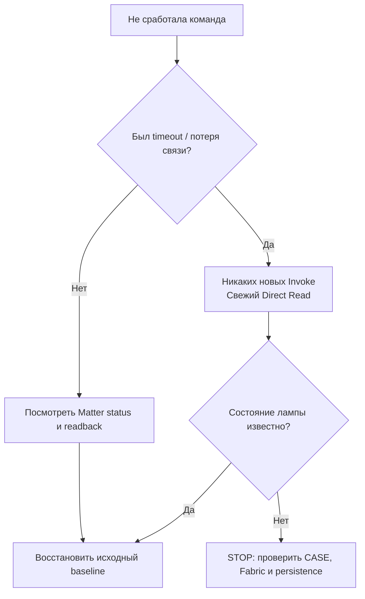

# 04 · Диагностика: исправляем проблему без сброса лампы

[← Управление](03_CONTROL_RU.md) · [На главную](00_START_RU.md) · [English](04_RECOVERY_EN.md)

**Правило №1:** после таймаута изменяющей команды нельзя нажимать «повторить» вслепую. Начните с чтения состояния.



## Быстро найти причину

| Симптом | Что означает | Что проверить | Чего не делать |
|---|---|---|---|
| `peer-ack-missing` при bootstrap | Несовместимость auto-subscription с прошивкой | одиночный Direct Read, `DISABLE_AUTO_SUBSCRIPTION=true` | не удалять Fabric |
| `get_nodes=[]` после AddNOC | Может быть локальная проблема регистрации, а не сопряжения | сохранённый `/data`, Fabric counters, один контролируемый restart | не комиссионировать второй раз |
| `Endpoint 1 does not exist` | Matter.js не построил полную endpoint-модель | `get_state`, patched image, точный Node ID | не включать произвольный raw invoke |
| `available=false`, но CASE есть | Subscription health ≠ прямой доступ | одиночный Direct Read | не сбрасывать лампу |
| `SupportedModes=""` | Особенность прошивки | `get_scenes`, 4 подтверждённых эффекта | не перебирать 24 enum-значения |
| Color music включён, свет статичен | UDP-кадры не поступают или не принимаются | прочитать enable и category=3, проверить UDP/4048 | повторять commissioning или отправлять слепые Invoke |
| После restart узел пропал | Не тот persistent `/data` или интерфейс | compose volume/image/interface | не создавать вторую Fabric вслепую |
| На Станции остался TCP/8765 | Cleanup не завершён | verify-clean и штатный rollback | не оставлять API открытым в LAN |

## Безопасный сбор диагностики

**Linux** (не копируйте сюда полное содержимое `/data`):

```bash
cd "$HOME/matter-lab"
docker compose ps
docker inspect --format '{{.State.Health.Status}} {{.RestartCount}}' matterjs-server
docker compose logs --tail=60 matter-server
```

**Рабочая машина** (при рабочем WebSocket):

```bash
MATTER_URI="ws://REPLACE_WITH_SERVER_IP:5580/ws"
NODE_ID="REPLACE_WITH_ACTUAL_MATTERJS_NODE_ID"
node tools/matter_lamp/matter-lamp-client.mjs --uri "$MATTER_URI" --node "$NODE_ID" get_health
node tools/matter_lamp/matter-lamp-client.mjs --uri "$MATTER_URI" --node "$NODE_ID" get_state
```

> **Не публикуйте сырой вывод без проверки:** логи могут содержать адреса устройств, пути, идентификаторы и временные параметры. Отчёты для issue обезличивайте.

## Три разные «откатить»

**После обычного изменения света:** восстановите *свой* OnOff/ColorMode/цвет/уровень/температуру по сохранённому снимку, каждый раз перечитывая состояние.

**После сбоя commissioning:** остановите изменяющие действия. Проверенный lifecycle обязан восстановить `platformd`, закрыть 8765 и выполнить `verify-clean`. Если результат неоднозначен, проверяйте Fabric/persistence только на чтение. Сохраняйте первоначальный `/data`.

**После неудачного обновления Docker:** верните исходный pinned image и ту же приватную конфигурацию, используя **тот же** `/data`. Не запускайте второй сервер с копией ключей и не применяйте `docker compose down -v`.

## Если всё работает — финальная проверка

- [ ] Яндекс по-прежнему управляет лампой.
- [ ] Matter.js делает Direct Read и запускает одну проверенную сцену.
- [ ] Станционный TCP/8765 закрыт по IPv4/IPv6.
- [ ] Нет работающих capture-helper или экспериментов после остановки.
- [ ] Приватные артефакты не вошли в Git.

[**Светомузыка — диагностика →**](05_COLOR_MUSIC_RU.md) · [**Вернуться к общей карте →**](00_START_RU.md)