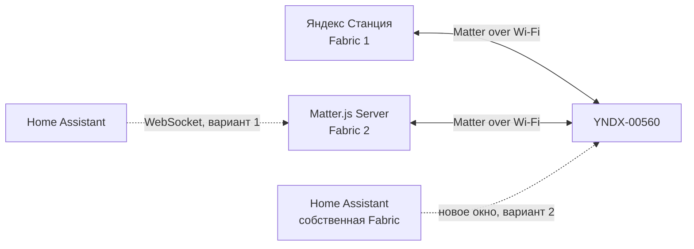

# Подключение Яндекс Эмби Лампы к дополнительному Matter-контроллеру (Multi-Admin)

> **Статус:** процедура добавления Matter.js Server как второй Fabric подтверждена на реальной Яндекс Эмби Лампе YNDX-00560. Интеграция с Home Assistant и открытие следующего окна через Matter.js описаны отдельно как **NOT TESTED**. Инструкция не требует повторения истории исследования, но требует понимания Linux, Docker, PowerShell и SSH.

Эта инструкция описывает один контролируемый эксперимент: сохранить существующее подключение лампы к Яндексу и добавить независимый Matter.js-контроллер. Она основана на [проверенном плане ECM](ECM_EXECUTION_PLAN.md), [результатах готовности](READINESS_REPORT.md), [возможностях устройства](DEVICE_CAPABILITIES.md) и [прямом управлении](DIRECT_CONTROL.md).

## 1. Что получим

Matter **Fabric** — отдельный домен доверия с собственной идентичностью контроллера, сертификатами и ACL. Matter **Multi-Admin** позволяет одному устройству состоять в нескольких Fabrics. Добавление второй Fabric не требует удаления первой: в проверенном опыте Яндекс Fabric сохранилась, а Matter.js Fabric получила собственный operational Node ID.



Matter.js Server — самостоятельный Matter-контроллер и WebSocket-сервис. Home Assistant — система автоматизации, которая может использовать существующий Matter Server либо создать собственную Fabric. Вторая Fabric даёт независимый путь `Linux → Matter.js → лампа`; проверены Direct Read, On/Off, яркость, Hue/Saturation и цветовая температура. Работа при физически отключённой Станции пока **NOT TESTED**.

## 2. Проверенные версии и требования

| Компонент | Проверено | Примечание |
|---|---:|---|
| Лампа | YNDX-00560 | Другие модели **NOT TESTED** |
| Станция | Яндекс Станция Мини 2 с root/SSH | Нерутированный штатный способ **UNKNOWN** |
| Прошивка Станции | `0.369.1.46.4793643989.20261020.299` | Скрипт проверяет firmware и SHA-256 `maind`; несовпадение — STOP |
| ОС контроллера | Ubuntu 22.04.5 LTS | Linux host networking предпочтителен |
| Matter.js Server | 1.5.5 | Образ проекта содержит узкий direct-control patch |
| matter.js | 0.18.0 | Persistence нельзя переносить между параллельными контроллерами |
| PowerShell | 7 | Контроллер lifecycle запускается с Windows |
| Node.js | 22 | Для CLI прямого управления |
| Native HTTP client | static AArch64 Linux | Сборка Zig; бинарник не хранится в Git |

Нужны:

- одна L2-сеть для лампы и Linux-сервера, рабочие IPv6 link-local и multicast;
- mDNS/DNS-SD по UDP/5353 и Matter по UDP/5540;
- Docker с Compose и host networking на Linux;
- постоянный приватный каталог `/data` Matter.js;
- root/SSH к Станции для подтверждённого первоначального метода;
- отсутствие доступа TCP/5580 из интернета и недоверенных сетей;
- локальный checkout этого репозитория и Zig для воспроизводимой сборки `maind-http-local`.

Универсальный способ инициировать Multi-Admin через нерутированную Яндекс Станцию нами не подтверждён. Не меняйте BL31, Secure Boot, загрузочные разделы или прошивку ради этой инструкции.

## 3. Карта процедуры: 20 обязательных шагов

1. Получить репозиторий и нужную ветку.
2. Собрать native HTTP-клиент.
3. Подготовить Linux host networking и persistent storage.
4. Собрать и запустить закреплённый Matter.js-образ.
5. Проверить health, WebSocket и пустой список узлов.
6. Проверить IPv6, multicast и mDNS.
7. Создать приватную резервную копию `/data`.
8. Проверить firmware, hash и чистое состояние Станции.
9. Подтвердить доступность лампы и ожидаемый Node ID.
10. Запустить только production lifecycle `MultiAdminECM`.
11. Установить IPv4/IPv6 guards и независимый watchdog.
12. Получить свежий `/devices` и сверить идентичность лампы.
13. Проверить исходные Matter-атрибуты.
14. Выполнить один `/commissioning/window`.
15. Передать временный код Matter.js только в памяти.
16. Завершить PASE, attestation, AddNOC и CommissioningComplete.
17. Проверить новый узел и две Fabrics.
18. Выполнить rollback и независимый `verify-clean` Станции.
19. Проверить прямое управление и восстановить исходное состояние.
20. Проверить persistence/restart и сохранить приватную резервную копию.

Любой FAIL до шага 14 означает STOP без открытия окна. Не обходите preflight.

## 4. Подготовка

### 4.1 Репозиторий и сборка native transport

```powershell
git clone https://github.com/r0ka-op/yandex-station-matter-bridge.git <REPO_DIR>
Set-Location <REPO_DIR>
git switch feature/matter-multi-admin-research
git status --short --branch
```

Соберите клиент из [исходника](../../tools/maind-http-local/maind-http-local.c) штатным [build script](../../tools/maind-http-local/build.sh):

```bash
cd <REPO_DIR>
sh tools/maind-http-local/build.sh
file deploy/maind-http-local/maind-http-local.aarch64
sha256sum deploy/maind-http-local/maind-http-local.aarch64
```

PASS: статический AArch64 Linux ELF создан. Lifecycle сам проверяет SHA-256, временно копирует файл в `/tmp` Станции и удаляет его при rollback. Не устанавливайте бинарник постоянно.

### 4.2 Matter.js Server

```bash
cd <REPO_DIR>
docker build -t yandex-matterjs-server:1.5.5-direct-v1 deploy/matter-server-direct
mkdir -p <MATTER_LAB_DIR>/matter-data
cp deploy/matter-server/docker-compose.ubuntu.yml <MATTER_LAB_DIR>/compose.yml
cd <MATTER_LAB_DIR>
```

Перед запуском отредактируйте копию `compose.yml`:

- `PRIMARY_INTERFACE=<LINUX_LAN_INTERFACE>`;
- `LISTEN_ADDRESS=127.0.0.1,<LINUX_LAN_INTERFACE>`;
- bind mount должен указывать на `<MATTER_LAB_DIR>/matter-data:/data`;
- оставьте `ENABLE_TEST_NET_DCL=true`;
- до появления operational Node ID не копируйте лабораторное значение `YNDX00560_DIRECT_INVOKE_NODE_ID`; direct-invoke должен оставаться fail-closed.

```bash
docker compose up -d
docker compose ps
docker inspect --format '{{.State.Health.Status}} {{.RestartCount}}' matterjs-server
docker compose logs --tail=100 matter-server
```

PASS: `healthy`, restart count `0`, WebSocket слушает `ws://<MATTER_SERVER_IP>:5580/ws`, persistence находится в `/data`. Не публикуйте compose override с секретами или содержимое `/data`.

### 4.3 Сеть

```bash
ip -br address show <LINUX_LAN_INTERFACE>
ip -6 route
ip maddr show dev <LINUX_LAN_INTERFACE>
ss -lntup
avahi-browse -rt _matterc._udp
```

До открытия окна отсутствие `_matterc._udp` у лампы нормально. FAIL: нет IPv6 link-local, multicast на LAN-интерфейсе, либо UDP/5353/5540 блокируется. Не меняйте маршруты/firewall вслепую.

### 4.4 Приватная резервная копия Matter.js

Размещайте backup вне Git и ограничьте права. Для согласованной копии остановите только Matter.js-контейнер, не удаляя volume:

```bash
cd <MATTER_LAB_DIR>
docker compose stop matter-server
umask 077
tar -C <MATTER_LAB_DIR> -czf <PRIVATE_BACKUP_DIR>/matter-data-before-ecm.tgz matter-data
chmod 600 <PRIVATE_BACKUP_DIR>/matter-data-before-ecm.tgz
docker compose start matter-server
docker compose ps
```

PASS: сервер снова healthy, Fabric identity/persistence сохранены. Никогда не используйте `docker compose down -v`.

### 4.5 Станция и лампа

```powershell
pwsh -NoProfile -File .\scripts\check_maind_http_station_readiness.ps1 `
  -SshAlias <STATION_SSH_ALIAS> `
  -OutputPath <PRIVATE_RESULTS_DIR>\station-readiness.json
```

PASS означает: firmware/hash ожидаемы, штатный `platformd` один, TCP/8765 закрыт, нет mounts/patches/guards/lock/unresolved lifecycle. При несовпадении hash или firmware остановитесь; не обходите проверку.

`-ExpectedNodeId` является обязательной защитой. Возьмите его только из ранее разрешённой read-only инвентаризации/сохранённого `/devices`; демонстрационный ID не используйте. Если идентичность устройства неизвестна, сначала выполните отдельный разрешённый read-only lifecycle, а не ослабляйте production-проверку.

Дополнительный read-only тест native POST (он всё равно временно активирует API, но не открывает окно):

```powershell
pwsh -NoProfile -File .\scripts\start_maind_http_multi_admin_ecm_transport_probe.ps1 `
  -ConfirmToken I_APPROVE_ONE_MULTI_ADMIN_ECM_READ_ONLY_TRANSPORT_PROBE `
  -SshAlias <STATION_SSH_ALIAS> `
  -StationIPv4 <STATION_IPV4> `
  -StationIPv6 <STATION_IPV6> `
  -ExpectedNodeId <YANDEX_FABRIC_NODE_ID> `
  -MatterServerWebSocketUri ws://<MATTER_SERVER_IP>:5580/ws `
  -WatchdogSeconds 1500
```

PASS: HTTP 200 с корректным framing, `WindowStatus=0`, rollback и `verify-clean` PASS.

## 5. Открытие окна и добавление Matter.js Fabric

Production-команда ниже выполняет защищённую последовательность целиком: preflight → guards → watchdog → временный API → baseline → ровно один POST → одно commissioning → readback → rollback. Не повторяйте её автоматически.

```powershell
pwsh -NoProfile -File .\scripts\start_maind_http_multi_admin_ecm.ps1 `
  -ConfirmToken I_APPROVE_ONE_MULTI_ADMIN_ECM_SESSION `
  -SshAlias <STATION_SSH_ALIAS> `
  -StationIPv4 <STATION_IPV4> `
  -StationIPv6 <STATION_IPV6> `
  -ExpectedNodeId <YANDEX_FABRIC_NODE_ID> `
  -MatterServerWebSocketUri ws://<MATTER_SERVER_IP>:5580/ws `
  -CommissioningTimeoutSeconds 600 `
  -MatterJsDiscoveryTimeoutSeconds 300 `
  -WatchdogSeconds 1500 `
  -Discriminator 0
```

`Discriminator=0` означает генерацию свежего CSPRNG-значения. Инструмент:

1. ставит IPv4/IPv6 guards **до** listener;
2. проверяет независимый station-side watchdog;
3. создаёт unique run ID, global lock и one-shot marker;
4. получает свежий Node ID через `/devices` и сверяет его с ожидаемым;
5. требует `AcceptedCommandList=[0,1,2]`, `WindowStatus=0`, `SupportedFabrics=5`, `CommissionedFabrics=1`;
6. один раз вызывает штатный `POST /commissioning/window` через `maind-http-local`;
7. валидирует ответ, но держит `manualCode`/QR только в памяти;
8. один раз вызывает Matter.js `commission_with_code` с `network_only=true`;
9. проверяет `get_nodes`, `CommissionedFabrics=2` и состояние окна;
10. немедленно восстанавливает штатный `platformd` и запускает независимый `verify-clean`.

Ожидаемая безопасная сводка (значения секретов редактируются):

```text
baseline: PASS
commissioning_window: PASS
temporary_code_present: true
matterjs_commissioning: SUCCESS
nodes: 0 -> 1
commissioned_fabrics: 1 -> 2
rollback: PASS
verify_clean: PASS
```

Если HTTP/SSH/WebSocket timeout произошёл после one-shot marker, результат неоднозначен: запрос мог выполниться. **Не повторяйте POST или commissioning.** Завершите rollback и проверьте read-only состояние/persistence.

## 6. Что происходит во время commissioning

1. Окно рекламирует `_matterc._udp` через mDNS.
2. Временный manual code задаёт PASE-сессию, но не содержит постоянные Fabric credentials.
3. Matter.js проверяет Device Attestation.
4. `AddNOC` добавляет сертификаты новой Fabric.
5. `CommissioningComplete` завершает commissioning.
6. Новый operational Node появляется в persistence Matter.js.

У YNDX-00560 использовался test/development PAA. При production-only trust policy получен подтверждённый `attestation-rejected`; `ENABLE_TEST_NET_DCL=true` позволил штатно доверить Test DCL и attestation прошла. Не отключайте attestation/revocation checks и не импортируйте произвольные PAA.

PASS: Matter.js `get_nodes` содержит новый узел, лампа сообщает две commissioned Fabrics, а исходная Яндекс Fabric остаётся. Индекс Fabric на лампе, локальный индекс контроллера и operational Node ID — разные величины.

## 7. Восстановление после AddNOC/CommissioningComplete

Подтверждённый сбой: `AddNOC` и `CommissioningComplete` успешны, peer online, затем `peer-ack-missing`, а `get_nodes=[]`. Это не разрешение повторить commissioning: вторая Fabric уже могла существовать.

1. Остановите изменяющие действия.
2. Создайте защищённую копию текущего `/data` вне Git.
3. Проверьте, что compose использует прежний image, bind mount, Fabric identity и credentials.
4. Ищите запись commissioned peer/operational Node ID только локально; не публикуйте storage или сертификаты.
5. Выполните один контролируемый restart того же сервера с тем же `/data`:

```bash
cd <MATTER_LAB_DIR>
docker compose restart matter-server
docker compose ps
docker compose logs --tail=150 matter-server
```

6. Через WebSocket/dashboard проверьте `server_info`, `get_nodes` с `only_available=false`, CASE и `ping_node`.

В проверенном случае peer восстановился из persistence, CASE прошёл, `get_nodes` изменился `0 → 1`. Запрещено удалять `/data`, менять Fabric identity, запускать второй контроллер с теми же credentials или повторять commissioning без установления фактического состояния лампы.

## 8. Проверка независимого управления

После появления operational Node ID задайте его в приватной копии compose как `YNDX00560_DIRECT_INVOKE_NODE_ID=<OPERATIONAL_NODE_ID>` и применяйте только после backup `/data`. Узкий server patch разрешает endpoint 1 и подтверждённые команды; это не универсальный raw invoke.

```bash
cd <REPO_DIR>
node tools/matter_lamp/matter-lamp-client.mjs --uri ws://<MATTER_SERVER_IP>:5580/ws --node <OPERATIONAL_NODE_ID> get_health
node tools/matter_lamp/matter-lamp-client.mjs --uri ws://<MATTER_SERVER_IP>:5580/ws --node <OPERATIONAL_NODE_ID> get_capabilities
node tools/matter_lamp/matter-lamp-client.mjs --uri ws://<MATTER_SERVER_IP>:5580/ws --node <OPERATIONAL_NODE_ID> get_state
```

Сохраните свежий snapshot, затем выполняйте по одной команде с readback:

```bash
node tools/matter_lamp/matter-lamp-client.mjs --uri ws://<MATTER_SERVER_IP>:5580/ws --node <OPERATIONAL_NODE_ID> turn_off
node tools/matter_lamp/matter-lamp-client.mjs --uri ws://<MATTER_SERVER_IP>:5580/ws --node <OPERATIONAL_NODE_ID> turn_on
node tools/matter_lamp/matter-lamp-client.mjs --uri ws://<MATTER_SERVER_IP>:5580/ws --node <OPERATIONAL_NODE_ID> set_brightness 50
node tools/matter_lamp/matter-lamp-client.mjs --uri ws://<MATTER_SERVER_IP>:5580/ws --node <OPERATIONAL_NODE_ID> set_color 15 80
node tools/matter_lamp/matter-lamp-client.mjs --uri ws://<MATTER_SERVER_IP>:5580/ws --node <OPERATIONAL_NODE_ID> set_color_temperature 4000
```

Параметры цвета — hue/saturation в процентах. Допустимая температура берётся из `get_capabilities`. После теста восстановите исходные OnOff, brightness и ColorMode/цвет/температуру, подтверждая каждый шаг свежим Direct Read.

Аппаратно подтверждены Direct Read, On/Off, brightness, Hue/Saturation, ColorTemperature, polling, persistence recovery и работа после restart. Автоматический subscription ломается на объединённом bootstrap Read до SubscribeRequest (`peer-ack-missing`), поэтому образ отключает auto-subscription и использует bounded direct reads/polling. `available=false` не равнозначно отсутствию CASE или Direct Read.

## 9. Home Assistant

### Вариант 1: существующий Matter.js Server

Добавьте Matter integration и укажите `ws://<MATTER_SERVER_IP>:5580/ws`. Это сохраняет одну независимую Fabric и общий `/data`, но полноценная интеграция Home Assistant с нашим patched server **NOT TESTED**. Из-за неполной локальной endpoint-модели стандартный `device_command` может вернуть `Endpoint 1 does not exist`; рабочий проектный путь — direct invoke + polling.

### Вариант 2: отдельная Fabric Home Assistant

Home Assistant может быть отдельным Matter-контроллером, но для этого нужно новое commissioning window и новый pairing flow. Этот вариант на YNDX-00560 **NOT TESTED**. Не используйте старый manual code и не удаляйте существующие Fabrics.

## 10. Следующий контроллер без Алисы — NOT TESTED

Matter.js Server 1.5.5 имеет WebSocket-команду `open_commissioning_window`. Установленная реализация использует `node_id` и `timeout` и открывает Enhanced Commissioning Window; заявленные `iteration`, `option`, `discriminator` в этой версии обработчиком не используются.

Фактическая форма запроса:

Ниже `123456789` — только демонстрационное числовое значение; замените его фактическим operational Node ID:

```json
{
  "message_id": "<UNIQUE_MESSAGE_ID>",
  "command": "open_commissioning_window",
  "args": {
    "node_id": 123456789,
    "timeout": 600
  }
}
```

Ответ содержит секретные `setup_pin_code`, `setup_manual_code` и `setup_qr_code`; не выводите и не логируйте его целиком. В репозитории нет публичного state-changing wrapper для этой операции. Используйте только аудированный WebSocket-клиент/штатный UI с one-shot semantics. Этот путь **NOT TESTED на нашей лампе** и не является гарантией.

## 11. Troubleshooting

| Симптом | Причина/статус | Диагностика | Безопасное решение | Не делать |
|---|---|---|---|---|
| Station API недоступен | API штатно выключен либо preflight FAIL | readiness, platformd, TCP/8765 | использовать production lifecycle | постоянный listener, обход hash check |
| Raw HTTP transport FAIL | старый BusyBox `wget/telnet` ненадёжен | native client hash/version/framing | пересобрать `maind-http-local` | повторять state-changing POST |
| `WindowStatus` не изменился | POST отклонён или результат неоднозначен | one-shot marker, HTTP status, read-only readback | rollback и остановка | слепой повтор |
| Нет `_matterc._udp` | окно закрыто либо mDNS/IPv6 проблема | `avahi-browse`, IPv6/multicast | проверить LAN во время окна | менять сеть без evidence |
| PASE error | код/окно/discovery timeout | structured reason и elapsed | остановка, read-only state | повторять старый code |
| `attestation-rejected` | подтверждён test/dev PAA при production-only trust | DCL/attestation stage | `ENABLE_TEST_NET_DCL=true` | отключать attestation, импортировать случайный PAA |
| `peer-ack-missing` | подтверждён при bootstrap subscription; и был после commissioning | CASE, direct single-path Read, UDP trace | polling/direct path; persistence recovery | считать Fabric отсутствующей |
| `get_nodes=[]` после AddNOC | local registration/persistence recovery | logs, storage record, same Fabric identity | backup и один controlled restart | новое commissioning, удалить `/data` |
| `Endpoint 1 does not exist` | interview не построил local model | Direct Read endpoint 1 | узкий direct-invoke path | универсальный raw invoke |
| Subscription bootstrap FAIL | combined attribute/event Read несовместим | ошибка до SubscribeRequest | disable auto-subscription + bounded polling | искусственно ставить available=true |
| CASE PASS, `available=false` | subscription health ≠ connectivity | ping/direct Read | оценивать health раздельно | удалять Fabric |
| После restart нет связи | неверный `/data`, interface или Fabric identity | compose mounts/env, get_nodes, CASE | восстановить исходный storage/config | запуск второго controller с копией keys |

## 12. Безопасность и точки остановки

- Не изменяйте BL31/Secure Boot, NAND или загрузочные разделы.
- Не выполняйте factory reset без отдельного recovery plan.
- Не вызывайте RemoveFabric/RevokeCommissioning и не меняйте ACL/Wi-Fi.
- Не публикуйте `/data`, backups, pairing codes, QR, certificates или private keys.
- Не запускайте два контроллера с одной Fabric identity и общими credentials.
- Не повторяйте POST/commissioning после timeout или потери ответа.
- При rollback/`verify-clean` FAIL не запускайте второй lifecycle.

Проектные инструменты ограничивают API allowlist, ставят guards до listener, используют watchdog 1500 секунд, monotonic deadlines, durable one-shot markers и rollback. Подробнее: [ECM execution plan](ECM_EXECUTION_PLAN.md), [recovery plan](RECOVERY_PLAN.md), [commissioning methods](COMMISSIONING_METHODS.md).

## 13. FAQ

**Удалится ли Яндекс Fabric?** Нет, подтверждённый Multi-Admin добавил вторую Fabric. Но ошибочные reset/RemoveFabric опасны и не входят в процедуру.

**Можно ли обойтись без root на Станции?** Для первоначального подтверждённого пути — нет. Официальный универсальный UI Яндекса для этого не подтверждён.

**Почему `ENABLE_TEST_NET_DCL=true`?** У проверенного устройства test/development PAA. Это включает доверие через Test DCL, а не отключает attestation.

**Почему устройство может быть unavailable, но управляться?** Автоматическая subscription не проходит bootstrap, тогда как CASE и небольшие Direct Read/Invoke работают.

**Можно ли сразу использовать Home Assistant?** Возможны два варианта из раздела 9, но оба именно в этой конфигурации пока не прошли аппаратную end-to-end проверку.

**Проверена ли работа без включённой Алисы?** Нет. Независимый Matter-путь подтверждён, но тест с физически недоступной Станцией ещё **NOT EXECUTED**.
