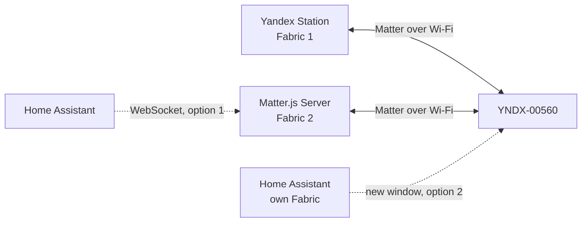

# Adding a Yandex Ambi Lamp to an Additional Matter Controller (Multi-Admin)

> **Status:** adding Matter.js Server as a second Fabric was verified on real Yandex Ambi Lamp YNDX-00560 hardware. Home Assistant integration and opening a later window through Matter.js are explicitly **NOT TESTED**. This guide assumes Linux, Docker, PowerShell, and SSH experience.

This self-contained guide preserves the existing Yandex connection while adding an independent Matter.js controller. It follows the verified [ECM execution plan](ECM_EXECUTION_PLAN.md), [readiness report](READINESS_REPORT.md), [device capabilities](DEVICE_CAPABILITIES.md), and [direct-control results](DIRECT_CONTROL.md).

## 1. Outcome

A Matter **Fabric** is an independent trust domain with its own controller identity, certificates, and ACL. Matter **Multi-Admin** lets one device belong to several Fabrics. Adding a second Fabric does not require deleting the first one: the verified experiment retained the Yandex Fabric and assigned a separate operational Node ID in the Matter.js Fabric.



Matter.js Server is a standalone Matter controller and WebSocket service. Home Assistant is an automation platform that can use an existing Matter Server or operate its own Fabric. The second Fabric provides an independent `Linux → Matter.js → lamp` path. Direct Read, On/Off, brightness, Hue/Saturation, color temperature, and polling were also verified while the Station was physically powered off.

## 2. Verified versions and requirements

| Component | Verified | Notes |
|---|---:|---|
| Lamp | YNDX-00560 | Other models are **NOT TESTED** |
| Station | Rooted Yandex Station Mini 2 with SSH | A stock, non-rooted workflow is **UNKNOWN** |
| Station firmware | `0.369.1.46.4793643989.20261020.299` | The script validates firmware and `maind` SHA-256; mismatch means STOP |
| Controller OS | Ubuntu 22.04.5 LTS | Linux host networking is preferred |
| Matter.js Server | 1.5.5 | The project image includes a narrow direct-control patch |
| matter.js | 0.18.0 | Never share persistence between concurrent controllers |
| PowerShell | 7 | Runs the lifecycle controller on Windows |
| Node.js | 22 | Runs the direct-control CLI |
| Native HTTP client | static AArch64 Linux | Reproducibly built with Zig; binary is not committed |

Requirements:

- lamp and Linux host on one L2 network, with working IPv6 link-local and multicast;
- mDNS/DNS-SD UDP/5353 and Matter UDP/5540;
- Docker Compose with Linux host networking;
- a private, persistent Matter.js `/data` directory;
- root/SSH access to the Station for the verified initial method;
- no exposure of TCP/5580 to the Internet or untrusted networks;
- this repository and Zig for building `maind-http-local`.

No universal first-time Multi-Admin flow through an unmodified Yandex Station has been verified. Do not modify BL31, Secure Boot, boot partitions, or firmware for this guide.

## 3. Procedure map: 20 mandatory steps

1. Check out the repository and target branch.
2. Build the native HTTP client.
3. Prepare Linux host networking and persistent storage.
4. Build and start the pinned Matter.js image.
5. Verify health, WebSocket, and an empty node list.
6. Verify IPv6, multicast, and mDNS.
7. Create a private `/data` backup.
8. Validate Station firmware, hash, and clean state.
9. Confirm lamp reachability and the expected Node ID.
10. Start only the production `MultiAdminECM` lifecycle.
11. Install IPv4/IPv6 guards and an independent watchdog.
12. Read fresh `/devices` and verify lamp identity.
13. Verify baseline Matter attributes.
14. Send exactly one `/commissioning/window` request.
15. Pass the temporary code to Matter.js in memory only.
16. Complete PASE, attestation, AddNOC, and CommissioningComplete.
17. Verify the new node and two Fabrics.
18. Roll back the Station and run independent `verify-clean`.
19. Test direct control and restore the initial lamp state.
20. Verify persistence/restart and keep a private backup.

Any FAIL before step 14 means STOP without opening a window. Never bypass preflight.

## 4. Preparation

### 4.1 Repository and native transport

```powershell
git clone https://github.com/r0ka-op/yandex-station-matter-bridge.git <REPO_DIR>
Set-Location <REPO_DIR>
git switch feature/matter-multi-admin-research
git status --short --branch
```

Build the [native source](../../tools/maind-http-local/maind-http-local.c) with the project [build script](../../tools/maind-http-local/build.sh):

```bash
cd <REPO_DIR>
sh tools/maind-http-local/build.sh
file deploy/maind-http-local/maind-http-local.aarch64
sha256sum deploy/maind-http-local/maind-http-local.aarch64
```

PASS: a static AArch64 Linux ELF exists. The lifecycle validates its SHA-256, stages it temporarily under `/tmp` on the Station, and removes it during rollback. Do not install it permanently.

### 4.2 Matter.js Server

```bash
cd <REPO_DIR>
docker build -t yandex-matterjs-server:1.5.5-direct-v1 deploy/matter-server-direct
mkdir -p <MATTER_LAB_DIR>/matter-data
cp deploy/matter-server/docker-compose.ubuntu.yml <MATTER_LAB_DIR>/compose.yml
cd <MATTER_LAB_DIR>
```

Edit the copied `compose.yml` before starting it:

- set `PRIMARY_INTERFACE=<LINUX_LAN_INTERFACE>`;
- set `LISTEN_ADDRESS=127.0.0.1,<LINUX_LAN_INTERFACE>`;
- bind `<MATTER_LAB_DIR>/matter-data:/data`;
- retain `ENABLE_TEST_NET_DCL=true`;
- do not copy the laboratory `YNDX00560_DIRECT_INVOKE_NODE_ID` before the actual operational Node ID is known; direct invoke must fail closed.

```bash
docker compose up -d
docker compose ps
docker inspect --format '{{.State.Health.Status}} {{.RestartCount}}' matterjs-server
docker compose logs --tail=100 matter-server
```

PASS: `healthy`, restart count `0`, WebSocket available at `ws://<MATTER_SERVER_IP>:5580/ws`, and persistent data mounted at `/data`. Do not publish local overrides or `/data`.

### 4.3 Network

```bash
ip -br address show <LINUX_LAN_INTERFACE>
ip -6 route
ip maddr show dev <LINUX_LAN_INTERFACE>
ss -lntup
avahi-browse -rt _matterc._udp
```

No `_matterc._udp` advertisement before a window is normal. FAIL if IPv6 link-local/multicast is missing or UDP/5353/5540 is blocked. Do not change routes or firewalls without evidence.

### 4.4 Private Matter.js backup

Store the archive outside Git with restricted permissions. Stop only the container for a consistent backup; do not remove its volume:

```bash
cd <MATTER_LAB_DIR>
docker compose stop matter-server
umask 077
tar -C <MATTER_LAB_DIR> -czf <PRIVATE_BACKUP_DIR>/matter-data-before-ecm.tgz matter-data
chmod 600 <PRIVATE_BACKUP_DIR>/matter-data-before-ecm.tgz
docker compose start matter-server
docker compose ps
```

PASS: the server returns healthy with the same Fabric identity and persistence. Never run `docker compose down -v`.

### 4.5 Station and lamp

```powershell
pwsh -NoProfile -File .\scripts\check_maind_http_station_readiness.ps1 `
  -SshAlias <STATION_SSH_ALIAS> `
  -OutputPath <PRIVATE_RESULTS_DIR>\station-readiness.json
```

PASS means expected firmware/hash, one stock `platformd`, no TCP/8765 listener, and no stale mounts, patches, guards, lock, or unresolved lifecycle. Stop on a hash or firmware mismatch; do not bypass it.

`-ExpectedNodeId` is a mandatory identity guard. Obtain it only from an earlier authorized read-only inventory or stored `/devices` result. Never use a demonstration ID. If identity is unknown, run a separately authorized read-only lifecycle rather than weakening production checks.

Optional read-only native POST probe (it temporarily activates the API but does not open a window):

```powershell
pwsh -NoProfile -File .\scripts\start_maind_http_multi_admin_ecm_transport_probe.ps1 `
  -ConfirmToken I_APPROVE_ONE_MULTI_ADMIN_ECM_READ_ONLY_TRANSPORT_PROBE `
  -SshAlias <STATION_SSH_ALIAS> `
  -StationIPv4 <STATION_IPV4> `
  -StationIPv6 <STATION_IPV6> `
  -ExpectedNodeId <YANDEX_FABRIC_NODE_ID> `
  -MatterServerWebSocketUri ws://<MATTER_SERVER_IP>:5580/ws `
  -WatchdogSeconds 1500
```

PASS: HTTP 200 with valid framing, `WindowStatus=0`, rollback PASS, and `verify-clean` PASS.

## 5. Open the window and add the Matter.js Fabric

The production command performs the protected flow end to end: preflight → guards → watchdog → temporary API → baseline → exactly one POST → one commissioning attempt → readback → rollback. Do not automatically rerun it.

```powershell
pwsh -NoProfile -File .\scripts\start_maind_http_multi_admin_ecm.ps1 `
  -ConfirmToken I_APPROVE_ONE_MULTI_ADMIN_ECM_SESSION `
  -SshAlias <STATION_SSH_ALIAS> `
  -StationIPv4 <STATION_IPV4> `
  -StationIPv6 <STATION_IPV6> `
  -ExpectedNodeId <YANDEX_FABRIC_NODE_ID> `
  -MatterServerWebSocketUri ws://<MATTER_SERVER_IP>:5580/ws `
  -CommissioningTimeoutSeconds 600 `
  -MatterJsDiscoveryTimeoutSeconds 300 `
  -WatchdogSeconds 1500 `
  -Discriminator 0
```

`Discriminator=0` requests a fresh CSPRNG value. The controller:

1. installs IPv4/IPv6 guards before the listener;
2. self-tests the independent Station-side watchdog;
3. creates a unique run ID, global lock, and durable one-shot markers;
4. obtains a fresh Node ID from `/devices` and checks it;
5. requires `AcceptedCommandList=[0,1,2]`, `WindowStatus=0`, `SupportedFabrics=5`, and `CommissionedFabrics=1`;
6. calls the stock `/commissioning/window` once through `maind-http-local`;
7. validates the response while keeping manual/QR codes in memory;
8. calls Matter.js `commission_with_code` once with `network_only=true`;
9. checks `get_nodes`, `CommissionedFabrics=2`, and window state;
10. restores stock `platformd` immediately and runs independent `verify-clean`.

Expected redacted summary:

```text
baseline: PASS
commissioning_window: PASS
temporary_code_present: true
matterjs_commissioning: SUCCESS
nodes: 0 -> 1
commissioned_fabrics: 1 -> 2
rollback: PASS
verify_clean: PASS
```

After an HTTP/SSH/WebSocket timeout following a one-shot marker, the result is ambiguous and the request may have executed. **Do not repeat the POST or commissioning.** Roll back and inspect read-only state/persistence.

## 6. Commissioning stages

1. The open window advertises `_matterc._udp` over mDNS.
2. The temporary manual code establishes PASE; it is not a permanent Fabric credential.
3. Matter.js validates Device Attestation.
4. `AddNOC` adds the second Fabric certificates.
5. `CommissioningComplete` closes the protocol flow.
6. Matter.js persists the commissioned peer and operational Node ID.

The tested YNDX-00560 used a test/development PAA. Production-only policy produced a confirmed `attestation-rejected`; retaining `ENABLE_TEST_NET_DCL=true` enabled normal Test DCL trust and attestation passed. Do not disable attestation/revocation checks or import arbitrary PAA certificates.

PASS: `get_nodes` contains the peer, the lamp reports two commissioned Fabrics, and the Yandex Fabric remains. A lamp Fabric index, the controller's local Fabric index, and an operational Node ID are different identifiers.

## 7. Recovering after AddNOC/CommissioningComplete

A verified failure mode was: successful `AddNOC`, `CommissioningComplete`, label update, and online peer; then `peer-ack-missing` and `get_nodes=[]`. This is not permission to recommission—the second Fabric may already exist.

1. Stop all state-changing actions.
2. Back up current `/data` securely outside Git.
3. Verify the same image, bind mount, Fabric identity, and credentials are configured.
4. Inspect the commissioned peer/operational Node ID locally only; never publish storage or certificates.
5. Restart the same server once with the same `/data`:

```bash
cd <MATTER_LAB_DIR>
docker compose restart matter-server
docker compose ps
docker compose logs --tail=150 matter-server
```

6. Check `server_info`, `get_nodes` with `only_available=false`, CASE, and `ping_node` through the WebSocket API/dashboard.

In the verified case the peer was recovered from persistence, CASE passed, and `get_nodes` became `0 → 1`. Never erase `/data`, change Fabric identity, run a second controller with copied credentials, or recommission before establishing the lamp's actual state.

## 8. Verify independent control

After learning the operational Node ID, set it in a private compose copy as `YNDX00560_DIRECT_INVOKE_NODE_ID=<OPERATIONAL_NODE_ID>` only after a `/data` backup. The narrow patch only permits endpoint 1 and verified commands; it is not a general raw-invoke interface.

```bash
cd <REPO_DIR>
node tools/matter_lamp/matter-lamp-client.mjs --uri ws://<MATTER_SERVER_IP>:5580/ws --node <OPERATIONAL_NODE_ID> get_health
node tools/matter_lamp/matter-lamp-client.mjs --uri ws://<MATTER_SERVER_IP>:5580/ws --node <OPERATIONAL_NODE_ID> get_capabilities
node tools/matter_lamp/matter-lamp-client.mjs --uri ws://<MATTER_SERVER_IP>:5580/ws --node <OPERATIONAL_NODE_ID> get_state
```

Save a fresh state snapshot, then issue one command at a time with readback:

```bash
node tools/matter_lamp/matter-lamp-client.mjs --uri ws://<MATTER_SERVER_IP>:5580/ws --node <OPERATIONAL_NODE_ID> turn_off
node tools/matter_lamp/matter-lamp-client.mjs --uri ws://<MATTER_SERVER_IP>:5580/ws --node <OPERATIONAL_NODE_ID> turn_on
node tools/matter_lamp/matter-lamp-client.mjs --uri ws://<MATTER_SERVER_IP>:5580/ws --node <OPERATIONAL_NODE_ID> set_brightness 50
node tools/matter_lamp/matter-lamp-client.mjs --uri ws://<MATTER_SERVER_IP>:5580/ws --node <OPERATIONAL_NODE_ID> set_color 15 80
node tools/matter_lamp/matter-lamp-client.mjs --uri ws://<MATTER_SERVER_IP>:5580/ws --node <OPERATIONAL_NODE_ID> set_color_temperature 4000
```

Hue and saturation are percentages. Use the temperature range returned by `get_capabilities`. Restore initial OnOff, brightness, ColorMode/color/temperature and verify every restoration with a fresh Direct Read.

Hardware PASS: Direct Read, On/Off, brightness, Hue/Saturation, ColorTemperature, polling, persistence recovery, and operation after restart. Auto-subscription fails during a combined bootstrap Read before SubscribeRequest (`peer-ack-missing`), so the image disables auto-subscription and uses bounded direct reads/polling. `available=false` does not mean CASE or Direct Read failed.

### Built-in scenes through the independent Fabric

```bash
node tools/matter_lamp/matter-lamp-client.mjs --uri ws://<MATTER_SERVER_IP>:5580/ws --node <OPERATIONAL_NODE_ID> get_scenes
node tools/matter_lamp/matter-lamp-client.mjs --uri ws://<MATTER_SERVER_IP>:5580/ws --node <OPERATIONAL_NODE_ID> get_scene
node tools/matter_lamp/matter-lamp-client.mjs --uri ws://<MATTER_SERVER_IP>:5580/ws --node <OPERATIONAL_NODE_ID> set_scene rainbow
node tools/matter_lamp/matter-lamp-client.mjs --uri ws://<MATTER_SERVER_IP>:5580/ws --node <OPERATIONAL_NODE_ID> set_scene fire
node tools/matter_lamp/matter-lamp-client.mjs --uri ws://<MATTER_SERVER_IP>:5580/ws --node <OPERATIONAL_NODE_ID> set_scene northern_lights
node tools/matter_lamp/matter-lamp-client.mjs --uri ws://<MATTER_SERVER_IP>:5580/ws --node <OPERATIONAL_NODE_ID> set_scene lava_lamp
```

The command uses endpoint `1`, ModeSelect `0x0050`, ChangeToMode `0x00`, and a
closed allowlist of IDs `1,4,6,13`. `get_scene` does not report the retained ID
as an active scene while the lamp is off or the vendor category is not `Scene`.
This firmware returns an empty string instead of a list for `SupportedModes`,
so `get_scenes` reports `deviceListAvailable=false` and separately lists only
hardware-verified modes rather than all 24 values of the general Quasar enum.

### Addition: independent Color music

On November 11, 2026, independent Matter.js Color music enable and Ubuntu UDP/4048 replay were hardware-tested, including operation with the Station physically powered off. This is a **separate step after commissioning**, not part of adding a Fabric. Supporting source scripts and patch remain local and are not included in this public repository. [Diagrams, contract, results and limits](../guide/05_COLOR_MUSIC_EN.md).

## 9. Home Assistant

### Option 1: use the existing Matter.js Server

Add the Matter integration and point it to `ws://<MATTER_SERVER_IP>:5580/ws`. This keeps one independent Fabric and one `/data`, but the complete Home Assistant integration with this patched server is **NOT TESTED**. Because the local endpoint model may be incomplete, standard `device_command` can report `Endpoint 1 does not exist`; the verified project path uses direct invoke plus polling.

### Option 2: give Home Assistant its own Fabric

Home Assistant may act as another controller, but it requires a new commissioning window and pairing flow. This is **NOT TESTED** on YNDX-00560. Never reuse an expired manual code or remove the existing Fabrics.

## 10. Add another controller without the Station — NOT TESTED

Matter.js Server 1.5.5 exposes the WebSocket command `open_commissioning_window`. The installed handler uses `node_id` and `timeout` and opens an Enhanced Commissioning Window; declared `iteration`, `option`, and `discriminator` fields are ignored by this version's handler.

Actual request shape:

In the example below, `123456789` is a demonstration numeric value only; replace it with the actual operational Node ID:

```json
{
  "message_id": "<UNIQUE_MESSAGE_ID>",
  "command": "open_commissioning_window",
  "args": {
    "node_id": 123456789,
    "timeout": 600
  }
}
```

The response contains secret `setup_pin_code`, `setup_manual_code`, and `setup_qr_code` values. Never print or log the raw response. The repository intentionally has no public state-changing wrapper for this operation; use only an audited WebSocket client or official UI with one-shot behavior. This route is **NOT TESTED on this lamp** and is not guaranteed.

## 11. Troubleshooting

| Symptom | Cause/status | Diagnose | Safe action | Never do |
|---|---|---|---|---|
| Station API unavailable | API is normally off or preflight failed | readiness, platformd, TCP/8765 | use production lifecycle | permanent listener, bypass hash check |
| Raw HTTP transport fails | BusyBox `wget/telnet` is unreliable | native version/hash/framing | rebuild `maind-http-local` | repeat state-changing POST |
| `WindowStatus` unchanged | rejected or ambiguous POST | marker, HTTP status, read-only readback | rollback and stop | blind retry |
| No `_matterc._udp` | closed window or mDNS/IPv6 issue | `avahi-browse`, multicast | check LAN during window | speculative network changes |
| PASE error | code/window/discovery issue | structured reason, elapsed time | stop and read state | reuse old code |
| `attestation-rejected` | confirmed test/dev PAA under production-only trust | DCL and stage | retain `ENABLE_TEST_NET_DCL=true` | disable verification/import arbitrary PAA |
| `peer-ack-missing` | confirmed at subscription bootstrap and once after commissioning | CASE, direct single-path Read, UDP trace | direct/polling or persistence recovery | assume Fabric is absent |
| Empty nodes after AddNOC | local registration/recovery issue | logs, storage record, identity | backup and one controlled restart | recommission/delete `/data` |
| `Endpoint 1 does not exist` | interview did not create model | Direct Read endpoint 1 | narrow direct-invoke path | expose general raw invoke |
| Subscription bootstrap fails | combined attribute/event Read incompatibility | failure before SubscribeRequest | disable auto-subscription + bounded polling | fake `available=true` |
| CASE PASS, unavailable | subscription health differs from connectivity | ping/direct Read | report health separately | remove Fabric |
| Connection lost after restart | wrong `/data`, interface, or identity | mounts/env/get_nodes/CASE | restore original storage/config | parallel controller with copied keys |

## 12. Safety and stop conditions

- Do not modify BL31/Secure Boot, NAND, or boot partitions.
- Do not factory-reset without a separate recovery plan.
- Do not invoke RemoveFabric/RevokeCommissioning or change ACL/Wi-Fi.
- Never publish `/data`, backups, pairing codes, QR payloads, certificates, or private keys.
- Never run two controllers with the same Fabric identity and credentials.
- Never retry POST/commissioning after a timeout or lost response.
- If rollback or `verify-clean` fails, do not start another lifecycle.

Project tooling uses a route allowlist, guards before the listener, a 1500-second watchdog, monotonic deadlines, durable one-shot markers, and rollback. See the [ECM execution plan](ECM_EXECUTION_PLAN.md), [recovery plan](RECOVERY_PLAN.md), and [commissioning methods](COMMISSIONING_METHODS.md).

## 13. FAQ

**Will this remove the Yandex Fabric?** No; the verified flow added a second Fabric. Reset/RemoveFabric operations are dangerous and excluded.

**Can the first pairing be done without root?** Not with the verified path. No universal official Yandex UI flow was confirmed.

**Why enable Test Net DCL?** The tested device uses a test/development PAA. This enables normal Test DCL trust; it does not bypass attestation.

**Why can the node be unavailable yet controllable?** Auto-subscription fails at bootstrap while CASE and small Direct Read/Invoke exchanges work.

**Can Home Assistant be used immediately?** The two architectures in section 9 are possible, but neither has completed an end-to-end hardware test in this exact setup.

**Was operation with the Yandex Station offline verified?** Yes. CASE, Direct Read, On/Off, brightness, Hue/Saturation, and polling passed while the Station was physically powered off; the initial lamp state was restored. The independent path remained healthy after the Station returned.
